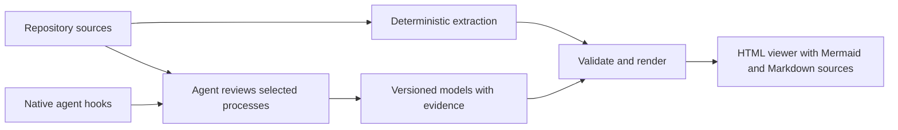

# Mermaider: architecture diagrams from code

**Keep architecture documentation in step with AI-assisted engineering.**

AI coding agents can change a repository faster than you can keep its architecture in your head. A service gains a queue, a deployment pipeline gains another stage, or a signup flow crosses a new boundary. Ask an LLM to explain the system again, and you may get a different account of the same code.

Mermaider turns repository sources and reviewed process models into **Mermaid architecture diagrams, workflow diagrams, and browsable HTML documentation**. It combines an agent skill, a TypeScript CLI, and native hooks for Codex and Claude Code. Choose the views that matter, keep their evidence alongside the code, and let the active agent maintain them as the repository changes.

Read the project story: [Mermaider: Code-Based Architecture Diagrams for AI Engineering](https://sebmer.com/projects/mermaider/).

[Create your first diagrams](#generate-architecture-diagrams-from-a-local-checkout) · [Install agent hooks](docs/installation.md) · [Try the synthetic example](examples/README.md)



**The same sources, reviewed models, configuration, and tool version produce the same files.** An LLM's interpretation of a business process still requires review. Mermaider records that interpretation with source evidence and keeps semantic review separate from documentation freshness.

## Architecture documentation you can inspect and maintain

- **See how the system fits together.** Keep selected architecture, dependency, database, deployment, and process diagrams in one HTML collection.
- **Review the evidence.** Follow source references and coverage notes, and inspect Mermaid and Markdown text in a pull request or with a coding agent.
- **Catch documentation drift.** Check whether selected inputs, evidence, or generated files have changed. Native hooks can ask the current agent to review stale diagrams during an active session.
- **Keep a useful scope.** Start with a few relevant views. Mermaider saves your choices and suggests newly discovered topics instead of silently expanding the documentation.

The HTML viewer works offline and shows one diagram at a time. Short navigation labels, pan, and **Fit**, **−**, **+**, and **100%** controls make dense views easier to read. Mermaid renders the visual as SVG inside HTML; `.mmd`, `.md`, and structured JSON models keep the underlying information available as text for humans and agents.

## Mermaid diagram types and supported sources

| Topic                   | Extracted foundation                           | Agent contribution                                         |
| ----------------------- | ---------------------------------------------- | ---------------------------------------------------------- |
| Architecture            | Declared Wrangler resources                    | Boundaries, responsibilities, and relationships            |
| Dependencies            | Package/Cargo manifests and TypeScript imports | Useful grouping and explanation                            |
| Pipelines               | GitHub Actions jobs and dependencies           | Deployment or release semantics spanning multiple systems  |
| Data                    | Supported declarative SQL and migrations       | Domain context and unsupported schema operations           |
| States                  | Source evidence                                | Verified transitions, guards, and failures                 |
| Processes and sequences | Source evidence                                | Signup, provisioning, deployment, and other selected flows |

The core reads Wrangler configuration, package and Cargo manifests, TypeScript imports, GitHub Actions workflows, and supported declarative SQL/migrations. Dynamic or unsupported constructs produce diagnostics rather than invented behavior. Source declarations describe implemented intent; planned designs and observed runtime behavior use separately labeled models. A list of status values alone does not establish valid state transitions.

## Generate architecture diagrams from a local checkout

Requires Node.js 22.13 or later and Git. Version 0.1 uses a built checkout; these instructions do not depend on an npm registry release.

```sh
git clone https://github.com/sebmer-com/mermaider.git
cd mermaider
npm ci
npm run build
node dist/cli.js discover --repo /absolute/path/to/your-repository
```

Follow the [installation guide](docs/installation.md) to load the built skill and native hooks into your agent, then ask:

> Use Mermaider to inspect this repository and show me the architecture, pipeline, data, and process diagrams that would be useful. Help me choose which to maintain.

The skill inspects the repository before asking about scope, audience, detail, and location. It saves those choices for later updates. For a deployment diagram, for example, it can extract declared CI job dependencies and help you review the release steps that span application code and external systems.

For a direct CLI workflow, inspect discovery first and choose the families you want:

```sh
node /absolute/path/to/mermaider/dist/cli.js init --repo /absolute/path/to/your-repository --families architecture,pipeline,data
node /absolute/path/to/mermaider/dist/cli.js update --repo /absolute/path/to/your-repository
node /absolute/path/to/mermaider/dist/cli.js check --repo /absolute/path/to/your-repository
```

`init` saves the currently discovered selection; it does not subscribe to every future diagram in those families. Select individual IDs with `--select` instead. Semantic flows use [reviewed models](skills/mermaider/references/models.md).

Open the generated `index.html` from the selected output directory. It contains all selected diagrams and works offline. The default placement follows repository/framework conventions: existing `docs/architecture/mermaider`, otherwise `docs/superpowers/mermaider` for Superpowers, otherwise `docs/mermaider`. Explicit user/configuration paths take precedence. See [framework-aware placement](docs/frameworks.md) and the [runnable synthetic example](examples/README.md).

The monochrome gallery follows the [Seb Builds brand](https://sebmer.com/brand/), with embedded Latin Modern headings, Arial controls, and no network dependency. Set a selection's optional `navLabel` when its full title is too long for navigation.

## Commands and files

| Command                                         | Purpose                                                                       |
| ----------------------------------------------- | ----------------------------------------------------------------------------- |
| `discover`                                      | Inspect sources and list possible diagrams; `--json` emits structured output  |
| `init`                                          | Create configuration from selected discovered IDs or families                 |
| `evidence --path <file>`                        | Obtain source evidence and its checksum; optional `--symbol <name>`           |
| `update`                                        | Validate and write the HTML collection plus selected Mermaid/Markdown sources |
| `check`                                         | Check freshness, model evidence, and Mermaid syntax without updating outputs  |
| `hook --provider codex\|claude\|cursor\|gemini` | Read a native event from stdin and return agent context                       |

Repository commands accept `--repo <directory>`; hooks obtain the repository from their native event input. Run `--help` for the installed version's options. `update` and `check` also support `--json`.

Version `.mermaider/config.json`, semantic models, generated HTML/diagram sources, and the generated manifest together. Local hook state and locks are disposable coordination data. Explicitly mapped Markdown blocks can update existing chapters while preserving surrounding prose; the HTML collection is generated in addition. See [configuration](docs/configuration.md).

## Keep diagrams current with Codex and Claude Code hooks

Codex and Claude Code integrations check repository state at session start, after tools, and before completion. When selected documentation is stale, the hook asks the **current agent** to run the skill. It neither launches a second agent nor makes a commit. A completion hook requests at most one additional maintenance pass per user turn, including when the input fingerprint changes during that pass; failures remain visible without repeated forced continuation.

Hook operation requires a running, supported local client and trusted hooks. A commit made while the agent is closed is noticed at the next eligible session/event. Mermaider is not a background service. Hooks respect reported plan/read-only/cancelled execution states, and the skill always respects the session's permissions. Repository instructions still determine whether documentation belongs in the same commit or a separate one.

Codex/Claude adapter behavior is covered by executable contract tests. A Claude Code 2.1.281 smoke test also verified that SessionStart context invoked the packaged skill, updated stale diagram/HTML output, and completed `check` with normal permissions. Real client installation remains a separate [smoke check](docs/installation.md#verify-a-native-installation); one tested client version does not certify every version. Cursor and Gemini definitions are experimental adapter preparation.

## Use Mermaider with Superpowers and Oh My Codex

Mermaider works independently and complements agent workflows such as [Superpowers](https://github.com/obra/superpowers) and [Oh My Codex](https://github.com/Yeachan-Heo/oh-my-codex). Planning and implementation workflows benefit from maintained views of the current system: service boundaries, database relationships, deployment stages, and user flows.

With Superpowers, use discovery/planning to agree on diagrams and verification to check them. With Oh My Codex, use the active task workflow and its repository guidance. The skill saves HTML under the repository's appropriate docs folder, without changing either framework's plans or runtime state. Neither framework is a dependency or fork target.

## Frequently asked questions

### Is architecture generation fully deterministic?

Extraction and rendering are deterministic for the same inputs and tool version. Process meaning, business rules, and boundaries may need an agent's interpretation and human review. Mermaider stores those decisions in versioned models with evidence; it does not claim that every architectural fact can be inferred automatically from code.

### Can an LLM read the diagrams?

Yes. Mermaid source (`.mmd`) and Markdown (`.md`) accompany the HTML viewer, and semantic models and JSON discovery output expose structured information. The viewer embeds SVG for visual rendering. There is no dedicated XML export.

### Will a new commit update the diagrams automatically?

Trusted hooks can request maintenance from a running supported agent. The configuration supports change-based or commit-based triggers. A commit made with the agent closed is detected at the next eligible session or event; no background agent is started.

### Can I keep existing architecture documentation?

Yes. Explicitly mapped Markdown blocks let Mermaider maintain selected sections while preserving surrounding prose. It also generates the HTML collection. Choose the scope and output location with the skill, and see the [configuration guide](docs/configuration.md) for ownership and evidence rules.

### Which coding agents are supported?

Codex and Claude Code have native adapters with executable contract tests; a live Claude Code smoke test is documented above. Cursor and Gemini integrations are experimental. See the [installation guide](docs/installation.md) for setup, trust controls, and client verification.

## Development

```sh
npm ci
npm run check
```

Tests use synthetic repositories. The suite covers extraction, model validation, reproducibility, source changes, managed output, and hook coordination. CI builds and tests the package; it does not publish or deploy anything.

The v1 limitations and extension boundaries are described in [design notes](docs/design.md). Contributions should preserve explicit source evidence and report unsupported cases instead of guessing.

Create a code-based view of your repository with the [installation guide](docs/installation.md), or explore the [synthetic example](examples/README.md) before connecting your agent.

Licensed under [Apache-2.0](LICENSE).
