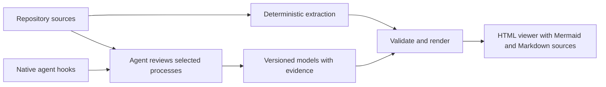

# Mermaider

**Keep repository diagrams connected to the code that explains them.**

Mermaider combines a coding-agent skill, a TypeScript CLI, and native agent hooks. The agent discovers useful topics with you, reviews the meaning of a process, and maintains evidence-backed models. The executable core extracts declared facts, validates the models, and generates a browsable **HTML diagram collection** plus Mermaid and Markdown sources.



The same sources, models, configuration, and tool version produce the same files. **LLM interpretation is not deterministic.** Fresh output and a reviewed business process are different assertions.

## What it can diagram

| Topic                   | Extracted foundation                           | Agent contribution                                         |
| ----------------------- | ---------------------------------------------- | ---------------------------------------------------------- |
| Architecture            | Declared Wrangler resources                    | Boundaries, responsibilities, and relationships            |
| Dependencies            | Package/Cargo manifests and TypeScript imports | Useful grouping and explanation                            |
| Pipelines               | GitHub Actions jobs and dependencies           | Deployment or release semantics spanning multiple systems  |
| Data                    | Supported declarative SQL and migrations       | Domain context and unsupported schema operations           |
| States                  | Source evidence                                | Verified transitions, guards, and failures                 |
| Processes and sequences | Source evidence                                | Signup, provisioning, deployment, and other selected flows |

Dynamic or unsupported constructs produce diagnostics rather than invented behavior. Source declarations describe implemented intent; planned designs and observed runtime behavior use separately labeled models.

## Start from a local checkout

Requires Node.js 22.13 or later and Git. Version 0.1 uses a built checkout; these instructions do not depend on an npm registry release.

```sh
git clone https://github.com/sebmer-com/mermaider.git
cd mermaider
npm ci
npm run build
node dist/cli.js discover --repo /absolute/path/to/your-repository
```

Install the skill and native hooks with the [installation guide](docs/installation.md), then ask:

> Use Mermaider to inspect this repository and show me the architecture, pipeline, data, and process diagrams that would be useful. Help me choose which to maintain.

The skill asks about scope, audience, detail, and location after inspecting the repository. It saves those choices and uses them on later updates. New topics remain suggestions until selected.

For a direct CLI workflow, inspect discovery first and choose the families you want:

```sh
node /absolute/path/to/mermaider/dist/cli.js init --repo /absolute/path/to/your-repository --families architecture,pipeline,data
node /absolute/path/to/mermaider/dist/cli.js update --repo /absolute/path/to/your-repository
node /absolute/path/to/mermaider/dist/cli.js check --repo /absolute/path/to/your-repository
```

`init` saves the currently discovered selection; it does not subscribe to every future diagram in those families. Select individual IDs with `--select` instead. Semantic flows use [reviewed models](skills/mermaider/references/models.md).

Open the generated `index.html` from the selected output directory. It contains all selected diagrams and works offline. The default placement follows repository/framework conventions: existing `docs/architecture/mermaider`, otherwise `docs/superpowers/mermaider` for Superpowers, otherwise `docs/mermaider`. Explicit user/configuration paths take precedence. See [framework-aware placement](docs/frameworks.md) and the [runnable synthetic example](examples/README.md).

The gallery shows one diagram at a time, with short navigation labels and a large reading area. Pan the diagram or use **Fit**, **−**, **+**, and **100%** to inspect it. Source references and coverage notes expand when needed. The monochrome layout follows the [Seb Builds brand](https://sebmer.com/brand/), with embedded Latin Modern headings, Arial controls, and no network dependency. Set a selection's optional `navLabel` when its full title is too long for navigation.

## Commands and files

| Command                                         | Purpose                                                                       |
| ----------------------------------------------- | ----------------------------------------------------------------------------- |
| `discover`                                      | Inspect sources and list possible diagrams; `--json` emits structured output  |
| `init`                                          | Create configuration from selected discovered IDs or families                 |
| `evidence --path <file>`                        | Obtain source evidence and its checksum; optional `--symbol <name>`           |
| `update`                                        | Validate and write the HTML collection plus selected Mermaid/Markdown sources |
| `check`                                         | Check freshness, model evidence, and Mermaid syntax without updating outputs  |
| `hook --provider codex\|claude\|cursor\|gemini` | Read a native event from stdin and return agent context                       |

Repository commands accept `--repo <directory>`; hooks obtain the repository from their native event input. Run `--help` for the installed version's options. `update` and `check` also support `--json`.

Version `.mermaider/config.json`, semantic models, generated HTML/diagram sources, and the generated manifest together. Local hook state and locks are disposable coordination data. Explicitly mapped Markdown blocks can update existing chapters while preserving surrounding prose; the HTML collection is generated in addition. See [configuration](docs/configuration.md).

## Automatic maintenance

Codex and Claude Code integrations check repository state at session start, after tools, and before completion. When selected documentation is stale, the hook asks the **current agent** to run the skill. It neither launches a second agent nor makes a commit. A completion hook requests at most one additional maintenance pass per user turn, including when the input fingerprint changes during that pass; failures remain visible without repeated forced continuation.

Hook operation requires a running, supported local client and trusted hooks. A commit made while the agent is closed is noticed at the next eligible session/event. Mermaider is not a background service. Hooks respect reported plan/read-only/cancelled execution states, and the skill always respects the session's permissions. Repository instructions still determine whether documentation belongs in the same commit or a separate one.

Codex/Claude adapter behavior is covered by executable contract tests. A Claude Code 2.1.281 smoke test also verified that SessionStart context invoked the packaged skill, updated stale diagram/HTML output, and completed `check` with normal permissions. Real client installation remains a separate [smoke check](docs/installation.md#verify-a-native-installation); one tested client version does not certify every version. Cursor and Gemini definitions are experimental adapter preparation.

## Superpowers, Oh My Codex, and other workflows

Mermaider works independently. With [Superpowers](https://github.com/obra/superpowers), use discovery/planning to agree on diagrams and verification to check them. With [Oh My Codex](https://github.com/Yeachan-Heo/oh-my-codex), use the active task workflow and its repository guidance. The skill saves HTML under the repository's appropriate docs folder, without changing either framework's plans or runtime state. Neither framework is a dependency or fork target.

## Development

```sh
npm ci
npm run check
```

Tests use synthetic repositories. The suite covers extraction, model validation, reproducibility, source changes, managed output, and hook coordination. CI builds and tests the package; it does not publish or deploy anything.

The v1 limitations and extension boundaries are described in [design notes](docs/design.md). Contributions should preserve explicit source evidence and report unsupported cases instead of guessing.

Licensed under [Apache-2.0](LICENSE).
